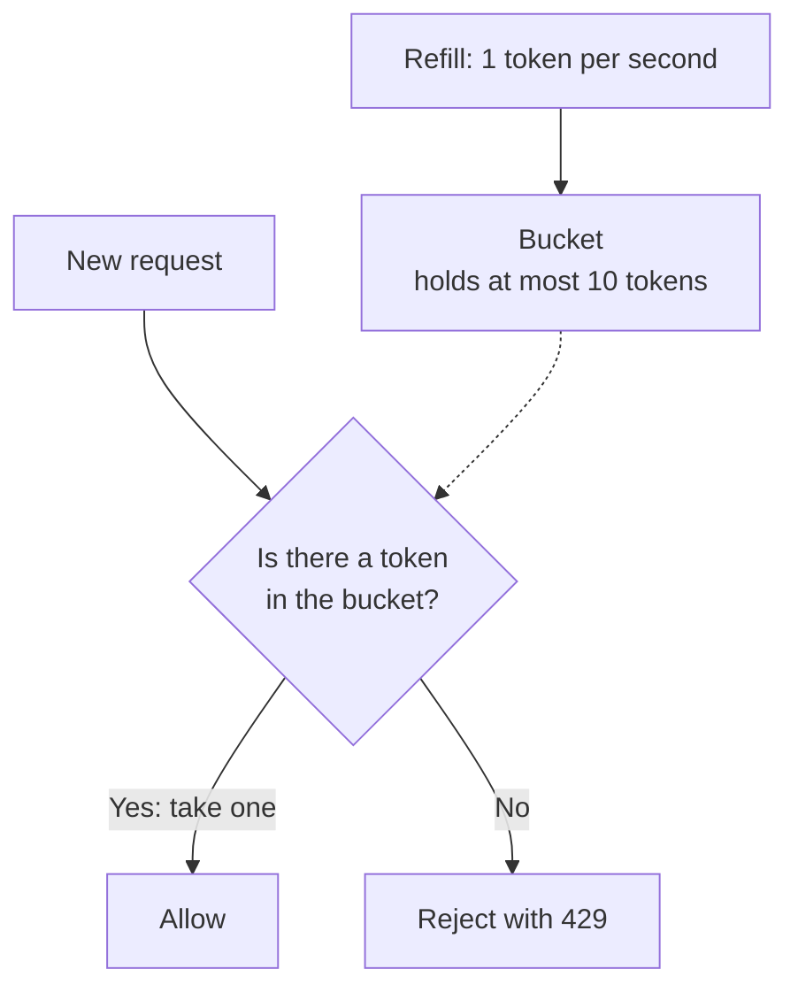
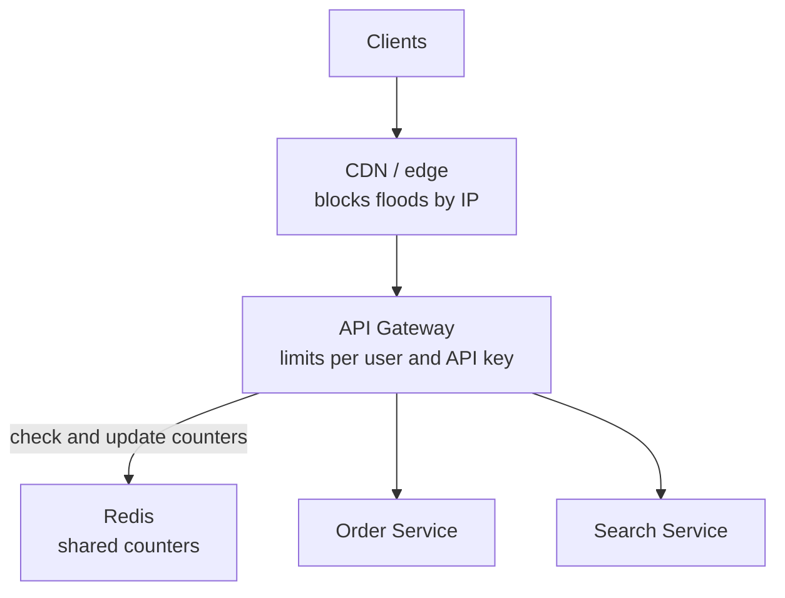

## The idea

A popular ride at an amusement park takes **20 people every 5 minutes**. When the line is long, the staff don't squeeze 100 people onto the ride. They ask people to wait. Everyone who rides has a good ride, and the ride doesn't break.

A **rate limiter** does the same for an API. It counts how many requests each user (or IP address, or API key) has sent. If they go over a limit, like **"100 requests per minute"**, the extra requests are rejected with `429 Too Many Requests`.

This page is about **how to count**. The full design of a rate limiting system is its own interview question: [Design a Rate Limiter](../questions/rate-limiter.mdx).

## Why rate limit

- **Protect the system.** A buggy script or a sudden spike can't overload your servers and hurt everyone else.
- **Stop abuse.** Slow down attackers guessing passwords, bots copying all your data, or spam accounts posting thousands of messages.
- **Fairness.** One heavy user can't use up the capacity everyone shares.
- **Control cost.** If each request costs you money, such as a paid SMS or AI service behind it, a limit caps the bill.
- **Paid plans.** A free plan gets 100 requests an hour, a paid plan gets 10,000.

### What to count by

| Key | Example |
| --- | --- |
| **User ID** | 100 requests per minute for each logged-in user |
| **API key** | 1,000 requests per hour for each app |
| **IP address** | 20 login attempts per minute from one IP. Careful: a whole office or mobile network can share one IP. |
| **Endpoint** | `POST /login` gets a much lower limit than `GET /products` |

You often combine them, for example per user **and** per IP on the login page.

### What the user gets back

```http
HTTP/1.1 429 Too Many Requests
Retry-After: 30
X-RateLimit-Limit: 100
X-RateLimit-Remaining: 0
```

`Retry-After` says how many seconds to wait. The `X-RateLimit-*` headers are a common habit, not an official standard, that tell the client its limit and how much is left (see [HTTP Methods, Status Codes and Headers](../foundations/http-methods-status-codes-headers.mdx)).

## The algorithms

There are five common ways to count. Every example below is for **one user**.

### 1. Token bucket

Picture a bucket that holds **tokens**. Think of them as tickets.

- The bucket holds at most **N** tokens. This is its **capacity**.
- New tokens drop in at a steady rate, like 1 per second. When the bucket is full, extra tokens are thrown away.
- Each request takes one token. No token left? The request is rejected.



**Worked example:** capacity 10, refill 1 token per second.

| Time | What happens | Tokens left | Result |
| --- | --- | --- | --- |
| 0 s | The bucket starts full | 10 | |
| 0 s | 10 requests arrive at once | 0 | All 10 allowed: a **burst** |
| 0 s | 1 more request | 0 | Rejected |
| 3 s | 3 tokens have dropped in. 2 requests arrive. | 1 | Both allowed |
| 60 s | Quiet for a minute. The bucket refills, but stops at 10. | 10 | |

So **short bursts up to the capacity are fine**, but over time the user can't go faster than the refill rate.

You only store **two numbers** per user: tokens left, and the time of the last refill. No timer is needed to add tokens. You work them out when a request arrives:

```js
function allowRequest(bucket, now) {
  // Add the tokens earned since last time, but never more than the capacity
  const secondsPassed = (now - bucket.lastRefill) / 1000;
  bucket.tokens = Math.min(bucket.capacity, bucket.tokens + secondsPassed * bucket.refillPerSecond);
  bucket.lastRefill = now;

  if (bucket.tokens >= 1) {
    bucket.tokens -= 1;
    return true; // allowed
  }
  return false; // rejected with 429
}
```

### 2. Leaky bucket

Picture a bucket with a small hole in the bottom. Water (requests) can pour in at any speed, but it **leaks out at one fixed speed**. If water comes in faster than it leaks out, the bucket fills up. Once it is full, extra water spills over the side: those requests are rejected.

In practice it is a **queue** of fixed size, first in, first out. A worker takes requests off the queue at a fixed rate.

**Worked example:** the queue holds 5, and 1 request leaks out per second. 8 requests arrive at the same moment.

- 5 go into the queue. **3 are rejected**, because the bucket is full.
- The 5 in the queue are handled one per second: the first right away, the last about 4 seconds later.

**Token bucket vs leaky bucket:** a token bucket lets a burst through **all at once**. A leaky bucket turns a burst into a **smooth, steady flow**. That is useful when the thing behind it can only take a fixed speed, like a partner API that allows 10 calls per second. The downside is that requests wait in line, which adds delay.

### 3. Fixed window counter

Split time into fixed windows, such as each clock minute: 10:00:00 to 10:00:59, then 10:01:00 to 10:01:59. Keep **one counter** per user per window. Each request adds 1. Over the limit? Reject. When a new window starts, counting starts again from zero.

**Worked example:** limit 5 per minute. The user sends 5 requests between 10:00:10 and 10:00:40, and all are allowed. A 6th at 10:00:50 is rejected. At 10:01:00 a new window starts, and requests are allowed again.

It is very simple to build with Redis:

```js
const key = `rate:${userId}:${currentMinute}`; // one key per user per minute
// MULTI runs both commands as one unit, so the key can never be left without an expiry
const [[, count]] = await redis
  .multi()
  .incr(key)        // add 1 and get the new count
  .expire(key, 60)  // clean up after the window
  .exec();          // ioredis returns [error, result] for each command
if (count > 5) return reject429();
```

**The problem: bursts at the edges.**

| Time | Window | Count in that window | Result |
| --- | --- | --- | --- |
| 10:00:59 | 10:00 | 5 requests | All allowed |
| 10:01:00 | 10:01 | 5 requests | All allowed |

That is **10 requests in 2 seconds**, with a limit of 5 per minute. Right at the edge between two windows, a user can get **twice** the limit.

### 4. Sliding window log

Keep a **log**: the time of every request the user made. When a new request comes in:

1. Remove the times older than one window (more than 60 seconds ago).
2. Count what is left.
3. If the count is under the limit, allow it and add its time to the log. If not, reject it.

**Worked example:** limit 3 per minute. The log holds 10:00:10, 10:00:30 and 10:00:50.

- A request at **10:01:05**. The last minute is 10:00:05 to 10:01:05. All 3 times are inside it, so the count is 3. **Rejected.**
- A request at **10:01:15**. The last minute is 10:00:15 to 10:01:15. The 10:00:10 entry drops out, so the count is 2. **Allowed**, and the log becomes 10:00:30, 10:00:50, 10:01:15.

It is **exact**: no burst at the edges. But it stores one entry **per request**. With a limit of 10,000 an hour, that can be 10,000 timestamps per user. In Redis it is often a **sorted set**, a set where each item has a score (here the time), so old entries are easy to remove.

### 5. Sliding window counter

A smart mix of the last two. Keep just **two counters**: this window's count and the previous window's count. Then **estimate** how many requests fell in the last 60 seconds, assuming the previous window's requests were spread evenly:

```text
estimate = currentCount + previousCount * (part of the previous window still inside the last 60 s)
```

**Worked example:** limit 100 per minute.

- The previous minute (10:00) had **80** requests.
- The current minute (10:01) has **30** so far.
- It is now 10:01:15. We are 25% into this minute, so the last 60 seconds still cover **75%** of the previous minute.
- Estimate = 30 + 80 × 0.75 = 30 + 60 = **90**. That is under 100, so the request is **allowed**.

Only two numbers per user, and the edge burst mostly goes away. It is an estimate, because it assumes the previous minute's requests were evenly spread. In practice it is very close.

## Side by side

| Algorithm | Bursts? | Memory per user | Accuracy | Good for |
| --- | --- | --- | --- | --- |
| **Token bucket** | Yes, up to the capacity | 2 numbers | Good | Most APIs. The usual default. |
| **Leaky bucket** | No, smoothed into a steady flow | A queue | Good | Protecting something that needs a steady speed |
| **Fixed window** | Up to 2× the limit at the edges | 1 counter | Rough at the edges | Simple limits where edges don't matter |
| **Sliding window log** | No | One entry per request | Exact | Small limits that must be exact, like login attempts |
| **Sliding window counter** | Very small | 2 counters | Very close | Large scale. A good middle ground. |

## Where to put the rate limiter



| Where | Good | Bad |
| --- | --- | --- |
| **In the client app** | Saves pointless calls | Never trust it. Attackers skip your app and call the API directly. |
| **At the edge** (CDN or firewall) | Stops floods before they reach your servers | Usually only sees the IP address and URL, not the user |
| **[API gateway](../hld-basics/api-gateway.mdx)** | One place for all services, and it knows the user from the token | The counters must be shared between gateway servers |
| **Inside a service** | Can use business rules, like "3 password resets per day" | Every team builds its own |

The API gateway is the usual answer, often with a simple per-IP limit at the edge as well.

**Many servers, one count.** If you run 10 gateway servers and each keeps its own counters, a user can get 10 times the limit by hitting different servers. So the counters usually live in a shared store like **Redis**. That brings new problems: two servers updating the same counter at once, Redis itself going down, users in many regions. Those belong to [Design a Rate Limiter](../questions/rate-limiter.mdx).

**If the limiter breaks.** If Redis goes down, do you let every request through (**fail open**) or block them all (**fail closed**)? For most APIs, failing open is the safer choice: a few minutes without limits hurts less than blocking every user.

**Rate limiting is not backpressure.** A rate limit is a fixed rule set in advance for each user. [Backpressure](./backpressure.mdx) reacts to how busy the system is right now.

## In the real world

**Stripe** wrote in 2017 about the rate limiters protecting its API. The main one is a **token bucket** for each user, kept in Redis. A second one limits how many requests a user can have **running at the same time**.

**AWS API Gateway** throttles requests with a **token bucket**. You set two numbers: the **rate** (the steady requests per second) and the **burst** (the bucket size).

**NGINX**, a very common web server, rate-limits with its `limit_req` setting, which uses the **leaky bucket** method.

**Cloudflare** described using the **sliding window counter**, with a previous and a current count, to rate-limit traffic across its network.

**GitHub's API** allows 60 requests an hour without logging in, and 5,000 an hour for a logged-in user.

## In the interview

Rate limiting comes up in almost every design ("how do you protect the API?"), and it is also its own question:

> "The API gateway rate-limits each user with a token bucket: a steady 100 requests per minute, with bursts up to 20. The counters live in Redis, so all gateway servers share them. Over the limit, we return 429 with a Retry-After header."

<Callout title="Remember this" type="success">
  - Rate limiting protects against overload and abuse, and keeps things fair. Return **429** with `Retry-After`.
  - **Token bucket:** tokens refill at a steady rate, bursts are fine up to the bucket size. The usual default.
  - **Leaky bucket:** a queue emptied at a fixed speed, so the output is smooth.
  - **Fixed window:** one counter per minute. Simple, but allows **2× bursts** at the window edges.
  - **Sliding window log** is exact but stores every request. **Sliding window counter** is a cheap, close estimate.
  - Put it in the **API gateway**, with counters in **Redis** shared by all servers.
</Callout>
