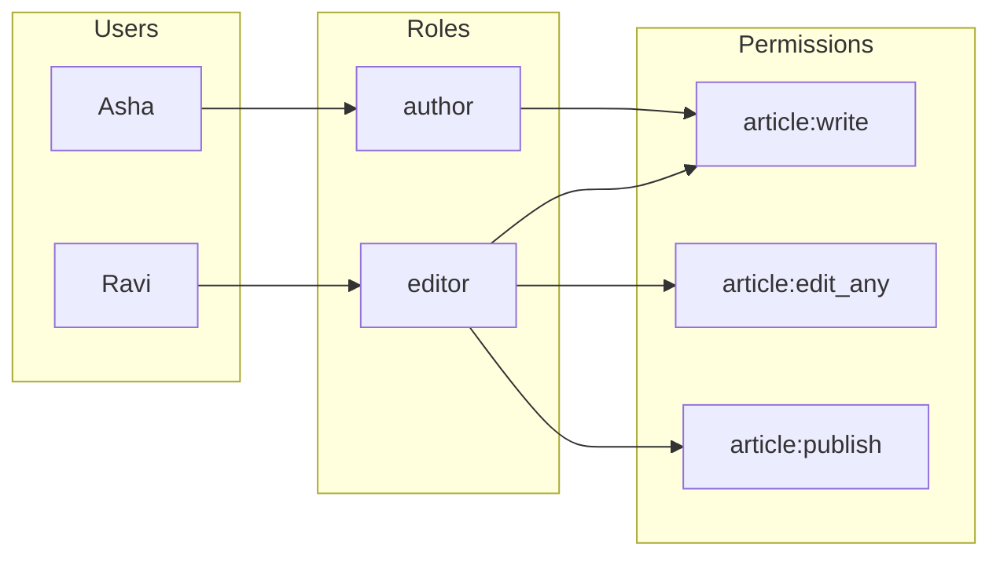

## What is it?

In an office building, doors open with badges. Nobody sets up every door for each of the 500 employees one by one. Instead there are a few badge **types**. A "Staff" badge opens the main doors. A "Finance" badge also opens the finance room. An "IT" badge also opens the server room. When Ravi joins the finance team, he gets a Finance badge. When he moves to IT, his badge type changes. No door has to be changed.

**Role-Based Access Control (RBAC)** works the same way. You don't give permissions to each user. You give permissions to **roles**, and then give users roles.

## Why do we need it?

**Giving permissions to each user one by one doesn't scale.** With 10,000 users and 50 permissions, that is up to 500,000 yes/no settings. Mistakes are easy to make and hard to spot. People collect access as they change jobs, and nobody removes the old access. And no one can quickly answer "who can delete users?"

Most people with the same job need the same access. RBAC groups that access once, under the job's name.

Why this helps:

- **Easy to manage.** You may have 10,000 users, but only 5 roles to think about.
- **Easy to check.** "Who can delete users?" Look at one role.
- **Easy to change.** A new employee gets the right access with one role. When someone leaves, remove their roles.

## How it works inside

### Users, roles and permissions

- A **permission** is one action on one kind of thing, like `article:write`, `article:publish` or `user:delete`.
- A **role** is a named set of permissions that matches a job, like `author`, `editor` or `admin`.
- A **user** gets one or more roles.



Can Ravi publish? Ravi has the `editor` role, and `editor` has `article:publish`. So yes. Can Asha? Her only role is `author`, which doesn't have it. So no.

### What a permission check does

1. **Find the user's roles**, in this team or project if roles are given per team.
2. **Expand the hierarchy**: an admin also gets everything an editor has.
3. **Collect the permissions** of all those roles into one set.
4. **Allow only if the permission asked for is in the set.** This is **deny by default**: no matching permission means no.

### An RBAC example

A news website:

| Permission | Reader | Author | Editor | Admin |
| --- | --- | --- | --- | --- |
| Read articles | Yes | Yes | Yes | Yes |
| Write drafts | | Yes | Yes | Yes |
| Edit anyone's article | | | Yes | Yes |
| Publish | | | Yes | Yes |
| Manage users | | | | Yes |

Each role here has everything the role before it has, plus a bit more. This is called a **role hierarchy**: admin includes editor, and editor includes author.

In a database, RBAC is usually four small tables:

```sql
CREATE TABLE roles            (id INT PRIMARY KEY, name TEXT UNIQUE);  -- 'editor'
CREATE TABLE permissions      (id INT PRIMARY KEY, name TEXT UNIQUE);  -- 'article:publish'
CREATE TABLE role_permissions (role_id INT, permission_id INT, PRIMARY KEY (role_id, permission_id));
CREATE TABLE user_roles       (user_id INT, role_id INT, PRIMARY KEY (user_id, role_id));

-- Can user 7 publish?
SELECT 1
FROM user_roles ur
JOIN role_permissions rp ON rp.role_id = ur.role_id
JOIN permissions p ON p.id = rp.permission_id
WHERE ur.user_id = 7 AND p.name = 'article:publish';
```

In your code, check the **permission**, not the role name:

```js
// Good: the code asks about the action
if (!can(user, "article:publish")) {
    return res.status(403).end();
}

// Less good: add a "chief editor" role later, and you must find and fix every check like this
if (user.role !== "editor" && user.role !== "admin") {
    return res.status(403).end();
}
```

**Making it fast.** Looking up roles in the database on every request adds work. Common options are to cache each user's permissions in Redis, or to put the roles inside the login token (a JWT, see [Cookies, Sessions and JWT](../foundations/cookies-sessions-jwt.mdx)). Both are fast, but both can go **stale**: if you remove someone's admin role, their token still says "admin" until it expires, and the cache keeps the old permissions. So delete the cached entry whenever a user's roles change, keep such tokens short-lived, or look up important permissions fresh.

**Roles per team.** In apps like Slack or GitHub, a person can be an admin in one team and a plain member in another. So the role is given **inside a team or project**, and the table becomes `user_roles (user_id, team_id, role_id)`. See [Multi-Tenancy](../advanced-components/multi-tenancy.mdx).

Good habits:

- **Least privilege.** Give each person the smallest role that lets them do their job.
- **Watch for role explosion.** If every special case gets its own new role ("editor-sports-only", "editor-but-no-delete"), you end up with more roles than people. That is a sign you need attributes (below).
- **Review regularly** who has admin, and remove access when people change jobs.

## When to use it

- **Users fall into clear job types**: viewer, editor, admin.
- **Business apps with teams or workspaces**, where each person gets a role per workspace.
- **Internal tools and company systems**, where access follows job titles.
- **Cloud and infrastructure access**, like Kubernetes or AWS.

**Don't use it when:**

- **The rule depends on the specific item**, like "edit only your own drafts". Add ownership checks or ABAC.
- **Access is shared item by item**, like Google Docs. Use relationship-based rules (ReBAC).
- **Every user needs a different mix of access.** You'd end up with one role per person (role explosion).

## Alternatives

| Option | What it is | Pick it when |
| --- | --- | --- |
| **Ownership checks in code** | "Is this order yours?" A simple `if` in the service | Users mostly touch their own data. Usually added on top of RBAC |
| **ACL (access control list)** | Each item keeps its own list of who may do what, like file permissions | Items are shared with a few people each |
| **ABAC** | Rules on facts about the user, the item and the situation | Detailed rules, like "managers approve up to 1,000 dollars". See below |
| **ReBAC** | Access comes from relationships: "shared with her team" | Sharing-heavy apps like Docs or Drive. See below |
| **A policy engine** (Open Policy Agent) | Rules written in a separate policy language, asked by every service | Many services must follow the same rules, and you want them in one place |

## RBAC vs ABAC, in short

RBAC can't easily say: **"authors can edit only their own articles"**, or "a doctor can read a patient's file only while treating that patient". The answer depends on the **specific item**, not just on the role.

**ABAC (Attribute-Based Access Control)** decides using **attributes**, meaning facts about the user, the item, the action and the situation:

```js
// ABAC rule: you may edit an article you wrote, while it is still a draft
function canEdit(user, article) {
    // A fact about the user and the item
    const isAuthor = article.authorId === user.id;

    // A fact about the item
    const isDraft = article.status === "draft";

    return isAuthor && isDraft;
}
```

| | RBAC | ABAC |
| --- | --- | --- |
| **Decides by** | The user's roles | Facts about the user, the item, the time, the place |
| **Example rule** | Editors can publish | Authors can edit their own drafts |
| **Good** | Simple. Easy to see who can do what. | Very flexible and detailed |
| **Bad** | Too many roles for special cases | Harder to understand and test: "why was this denied?" |

Most real apps mix them: **RBAC for the big picture**, plus a few ownership checks in code.

A third style is good to know: **ReBAC (relationship-based access control)**. Access comes from relationships: "Asha can edit this doc because it was shared with her team." Google Docs sharing works like this.

## In the real world

**Kubernetes.** Kubernetes uses RBAC to control who can do what in a cluster. A `Role` lists the allowed actions on resources, and a `RoleBinding` gives that role to a user or a service:

```yaml
apiVersion: rbac.authorization.k8s.io/v1
kind: Role
metadata:
  namespace: shop
  name: pod-reader
rules:
  - apiGroups: [""]
    resources: ["pods"]
    verbs: ["get", "list", "watch"]
```

**GitHub repository roles.** Repositories in a GitHub organization give people one of five roles: Read, Triage, Write, Maintain and Admin. Each one can do more than the one before.

**AWS IAM.** In AWS, permissions are written as JSON **policies** and attached to users, groups or roles. A policy can also have **conditions**, like "only if the resource has the same team tag as the user". That is how AWS supports ABAC.

**Google Zanzibar.** In 2019 Google published a paper on **Zanzibar**, its system for relationship-based permissions, used by products like Drive, YouTube and Calendar. Open-source projects such as SpiceDB and OpenFGA are based on its ideas.

## In the interview

When the system has different kinds of users, name the roles and say how you check them:

> "We use RBAC with three roles per workspace: viewer, editor and admin. The API checks permissions like `doc:edit`, not role names. On top of that, a simple ownership check lets users delete only their own comments."

<Callout title="Remember this" type="success">
  - **Permissions go to roles, roles go to users.**
  - **Why:** permissions per user don't scale. Thousands of users, but only a few jobs.
  - **Inside:** find the user's roles, expand the hierarchy, collect the permissions, **deny by default**.
  - Check **permissions** in code, not role names.
  - Roles are often given **per team or project**, not for the whole app.
  - Give the **least privilege** needed, and watch for **role explosion**.
  - **ABAC** uses facts (owner, time, department) for detailed rules. Most apps mix RBAC with ownership checks.
  - **Alternatives:** ownership checks, ACLs, ABAC, ReBAC, a policy engine.
</Callout>
