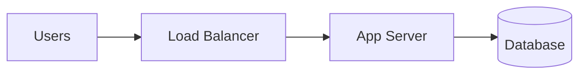
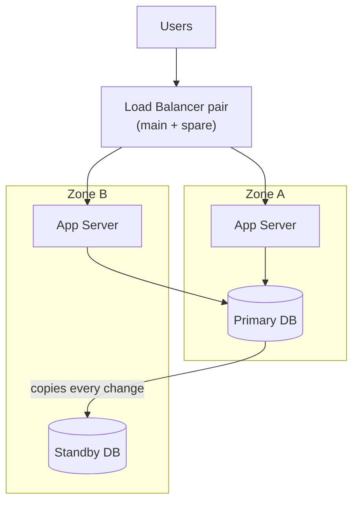
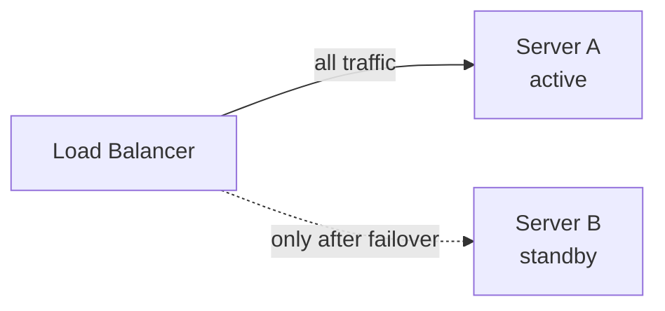
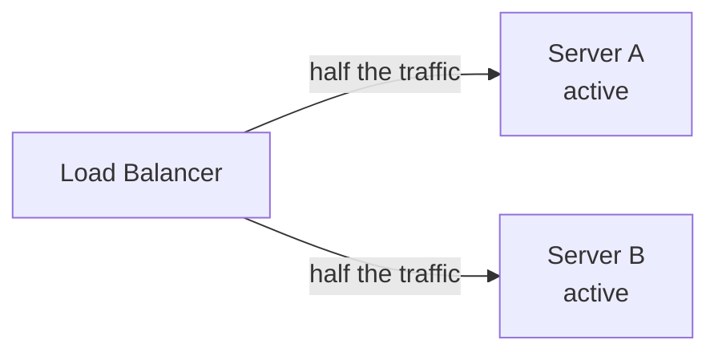
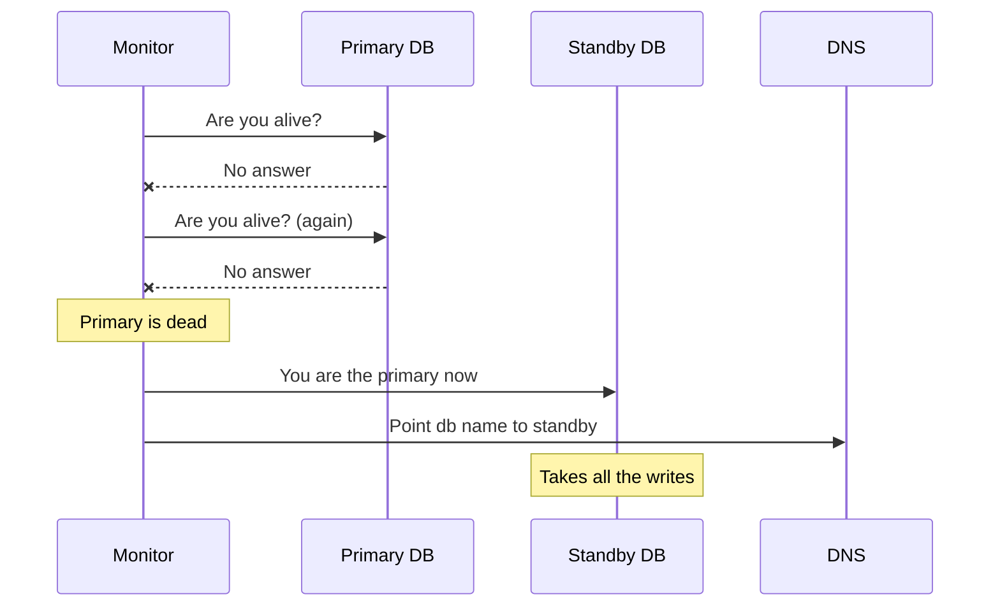

## What is it?

A hospital can't lose power in the middle of an operation. So it has a **backup generator**. When the city power goes out, the generator starts by itself, and within seconds the lights are back on.

That is the whole idea of this page:

- **Redundancy** means having a **spare copy** of every important part.
- **Failover** means **switching to the spare** when the main part breaks. Ideally it happens on its own, without waiting for a person.

Servers crash, disks die, networks break and whole data centers lose power. You can't stop parts from failing. But you can stop one failed part from taking the whole system down.

## Why do we need it?

**Every part fails sooner or later.** A server that is up 99.9% of the time is still down about **8.7 hours a year**. Multiply that by every server, disk, switch and data center in a system, and something is broken almost every day.

If the system needs **every** part to work, its uptime is worse than its weakest part. The fix is to stop needing any **one** part. With two copies that fail independently, both are down at the same time far less often than either one alone. (More on uptime numbers in [Availability and Reliability](../hld-basics/availability-reliability.mdx).)

### Single points of failure

A **single point of failure (SPOF)** is any part that takes everything down with it when it breaks. Look at this simple setup:

Every box here is a single point of failure. If the one app server crashes, the site is down. If the database disk dies, the site is down, and the data may be gone too.

To find them, point at each box in your design and ask: **"What happens if this one dies?"** If the answer is "everything stops", it needs a spare.

SPOFs also hide in places people forget:

- The **load balancer** itself.
- The **database**. It is often the last SPOF left in a design.
- **DNS**, an expiring certificate, or a config service that everything depends on.
- One **data center** or one **cloud region**.
- One **person** who is the only one who knows how to fix something.

## How it works inside

### Spare copies at every layer

Here is the same system with a spare at every layer. An **availability zone** is a separate data center (or group of them) in the same area, with its own power and network. Cloud providers split each region into several zones, so a fire or power cut in one zone doesn't hit the others.

| Layer | How to add a spare |
| --- | --- |
| **Load balancer** | Run two. If one dies, the other takes over its address. Cloud load balancers do this for you. |
| **App servers** | Run several **stateless** servers (see [Stateless vs Stateful](../hld-basics/stateless-vs-stateful.mdx)). Any one can die and the others carry on. |
| **Database** | Keep a **replica**, a live copy on another machine, and promote it if the main one dies (see [Replication](../databases/replication.mdx)). |
| **Data center** | Spread servers across **availability zones**. |
| **Region** | For the most important systems, a second region too (see [Disaster Recovery](./disaster-recovery.mdx)). |

A common rule is **N+1**: if you need N servers to handle the load, run N+1. Then one can fail, or be taken down for an update, and you still have enough.

Spares cost money. A spare that sits idle doubles the cost of that part, so you add them where a failure would hurt the most.

### Active-passive vs active-active

There are two ways to use a spare.

**Active-passive.** One copy does all the work (the **active** one). The spare (the **passive** one, or **standby**) waits, and only takes over when the active one fails. Like the hospital generator.

**Active-active.** All copies work at the same time and share the load. If one fails, the others take its share. Like a plane with two engines: both run all the time, and the plane can still fly on one.

| | Active-passive | Active-active |
| --- | --- | --- |
| **The spare** | Waits | Works all the time |
| **Cost** | You pay for a machine that sits idle | Every machine does useful work |
| **Switch-over** | Seconds to minutes | Almost instant: the load balancer stops sending traffic to the dead one |
| **Hard part** | Is the spare really ready? You only find out when you need it | Each copy must handle extra load when one dies. For databases, two copies taking writes can clash |
| **Typical use** | Databases with one primary, a load balancer pair sharing one address | Stateless app servers |

**Leave room in active-active.** If two servers each run at 80% and one dies, the other gets 160% of what it can handle and falls over too. With two servers, keep each well under 50%.

Databases are usually active-passive, because two copies accepting writes at the same time can end up with different data.

### Failover, step by step

What happens when the primary database dies:

<Steps>
<Step>

**Detect.** A monitor sends a small "are you alive?" check (a **health check** or **heartbeat**) every few seconds. One missed answer could be a short network blip, so it waits for several missed answers in a row. See [Health Checks](../hld-basics/health-checks-service-discovery.mdx).

</Step>
<Step>

**Decide.** Make sure it is really dead. Often several monitors vote, and a **majority** (a **quorum**) must agree. This stops one monitor with a bad network from starting a failover alone. See [Leader Election](../distributed-systems/leader-election-consensus.mdx).

</Step>
<Step>

**Promote.** The standby becomes the new primary and starts accepting writes.

</Step>
<Step>

**Redirect.** Send traffic to the new primary: update the DNS name, move a shared IP address, or update service discovery.

</Step>
<Step>

**Fence the old one.** Make sure the old primary can't accept writes if it wakes up. This is called **fencing**. Without it, you could have two primaries.

</Step>
<Step>

**Repair.** Fix or replace the old machine, and add it back as the new standby.

</Step>
</Steps>

### What can go wrong

- **Split brain.** The network between the two copies breaks, but both are still alive. Each thinks the other is dead, and both accept writes. Now there are two different versions of the data. The fix is a quorum vote plus fencing.
- **Lost writes.** If the standby is updated with a small delay (**asynchronous** replication), the last few writes before the crash may never reach it. They are gone after failover. **Synchronous** replication (the primary waits for the standby to confirm each write) avoids this, but makes every write a little slower.
- **Flapping.** The system fails over, then back, then over again, because the health check is too touchy. Require several failed checks in a row, and don't switch back automatically right away.
- **The spare doesn't work.** Its disk filled up months ago, or it has old settings. You only find out during the outage. Test failover regularly.

## When to use it

- **Anything users depend on** in production: the load balancer, app servers and the main database.
- **Parts that hold data you can't lose.** A database replica in another zone protects both uptime and data.
- **The pieces everything shares:** DNS, the auth service, config, the message broker.
- **Zones always, regions only when needed.** Spreading across two or three zones is cheap. A second region is for systems where hours of downtime would be very costly.

**Don't use it when:**

- **Downtime is cheap.** Dev and test setups, internal tools, or a batch job that can simply run again.
- **The spare costs more than the outage.** An idle standby doubles the cost of that part. Sometimes a restore from backup is good enough.
- **You won't test it.** An untested spare gives false comfort. Plan the failover drill along with the spare.

## Alternatives

| Option | What it is | Pick it when |
| --- | --- | --- |
| **Backups and restore** | No live spare. Rebuild from the last backup after a failure | Hours of downtime and some lost data are acceptable. See [Disaster Recovery](./disaster-recovery.mdx) |
| **Auto-restart / replace** | A supervisor (Kubernetes, an auto scaling group) restarts or replaces a dead server | Stateless servers, and a short gap while a new one starts is fine |
| **Managed services** | The cloud provider runs the spares for you (RDS Multi-AZ, S3, cloud load balancers) | You'd rather pay than build and test failover yourself |
| **Graceful degradation** | When a part fails, show less instead of failing | The broken part is not critical. See [Graceful Degradation](./graceful-degradation.mdx) |

## In the real world

**AWS RDS Multi-AZ.** Amazon's managed database service can keep a standby copy in another availability zone. Every write is copied to the standby before it is confirmed. If the primary fails, AWS points the database's DNS name at the standby, usually within one or two minutes. The app doesn't need any code change.

**GitHub, October 2018.** During network maintenance, GitHub's main US East Coast data center lost its connection for 43 seconds. Their automatic failover tool saw this and made databases on the West Coast the new primaries. When the network came back, some recent writes existed only on the East Coast, and new writes had gone to the West Coast. They couldn't simply be merged. GitHub chose to protect the data and ran in a degraded state for about 24 hours while it fixed things. A failover meant to help made the outage much longer.

**Netflix Chaos Monkey.** Netflix built a tool called Chaos Monkey that switches off random servers in production during working hours. Every team has to build its service so that losing a server doesn't matter. Netflix made it open source in 2012.

## In the interview

After you draw your first design, go box by box and remove each single point of failure:

> "Every layer has a spare. The app servers are stateless and run in two availability zones behind the load balancer. The database has a synchronous standby in another zone with automatic failover. During a failover we lose a minute of availability, but no data."

<Callout title="Remember this" type="success">
  - A **single point of failure** takes everything down. Ask "what if this dies?" for every box.
  - **Why:** every part fails sooner or later. With spares, the system no longer needs any **one** part to work.
  - **Redundancy** = spares at every layer: load balancer, app servers, database, zone.
  - **Active-passive:** the spare waits. **Active-active:** all copies work and share the load.
  - **Failover** = detect, decide, promote, redirect, fence the old one.
  - Watch out for **split brain** and **lost writes** with async replication.
  - **Test failover regularly.** An untested spare often doesn't work.
  - **Alternatives:** backups and restore, auto-restart, managed services, graceful degradation.
</Callout>
